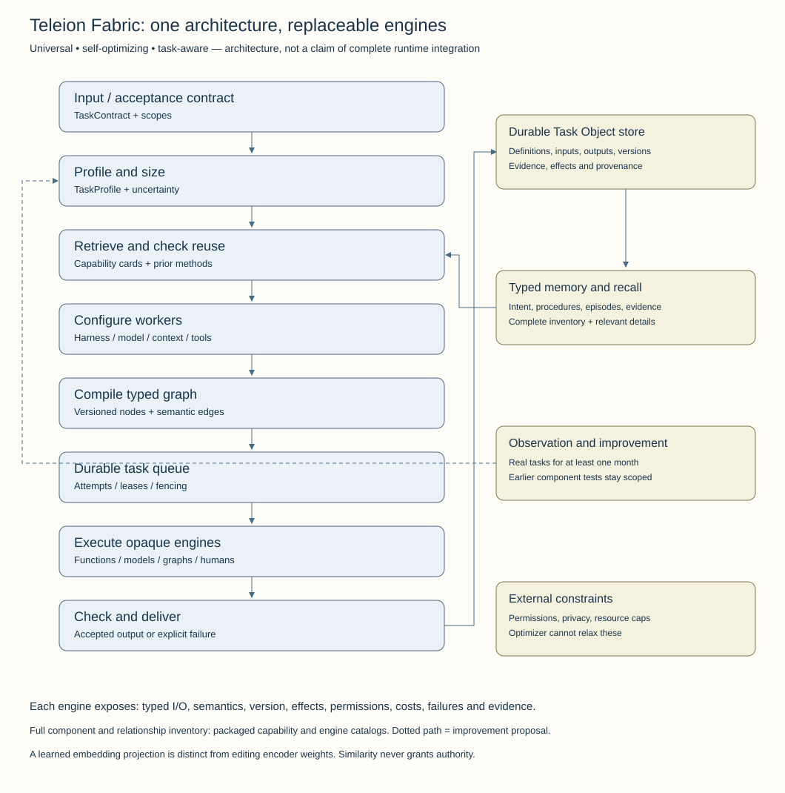

<!-- Teleion context: CHARTER.md sha256=6fe2bd046fd154952a79d25d81d1efcf8474ab4eabf034b105dcbe7b513e84ee; read AGENTS.md -->

# Teleion Fabric Python packages

Build solutions from versioned capability edges rather than repeatedly reading implementation internals.

```sh
python -m pip install "git+https://github.com/aidonerightcorp/teleion-fabric-python.git@v0.1.1"
teleion-fabric profile --input task.txt
teleion-fabric extract-json --input response.txt --type object
```

```python
from teleion_fabric import profile
from teleion_fabric.prose_tools import extract_json
from teleion_fabric.settings import load
print(profile("Clean a table; preserve **identifier strings**."))
print(extract_json('Result:\n```json\n{"ids":["001"]}\n```', "object"))
print(load("profiler"))
```

Run `python examples/compose_prose.py` for a typed two-engine composition that preserves identifier strings. `docs/ARCHITECTURE.md` describes the full lifecycle; CHARTER.md, CONSTITUTION.md and AGENTS.md carry governing context. Packaged resources expose all registered public family relationships, engine contracts and settings grids. MIGRATION.json tracks package coverage and external dependencies.

Included: deterministic task profiling, prose segmentation/JSON extraction, explicit setting selection, typed pure-engine composition, complete public architecture packets, a provider decision adapter, an OpenCode wrapper, and reusable core step tools/store/configuration mechanisms. One installable distribution exposes these Python modules; it does not create one dependency-heavy distribution per function.

OpenCode is an externally installed executable. `opencode_omninode.run` is a low-level invocation; `execute` takes a caller-provided durable sink and records start plus terminal state. The optional `persist` adapter requires the owning body-store provider to be installed; it is not bundled. Tool permissions and provider quotas remain caller/harness responsibilities. No provider credentials or models ship. Semantic profiling is optional: install `[semantic]` and set TELEION_EMBEDDING_MODEL_PATH to an already available encoder directory. Base installs make no network/model requests.

This is an initial portable release, not the entire historical fabric. Some legacy functions need external source packs or services; see MIGRATION.json. No queue deployment, automatic learning service, full weight-editing stack or general optimization gain is claimed. The earlier strict live pilot scored zero of five in each arm; output cleanup is a new mechanism, not a revision of that score.



The shared dimension catalog contains 88 settings descriptions (`load("dimensions")`). Some grids are design candidates, not implemented support or enforced limits. See NOTICE.md for source-release rights and dependency notices.
