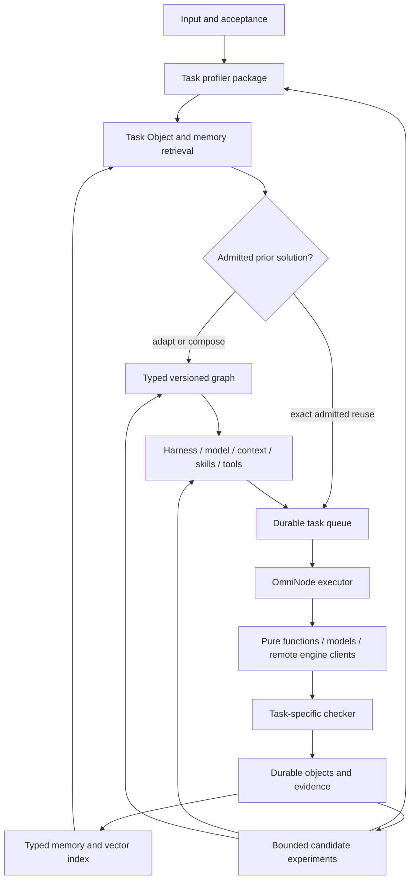
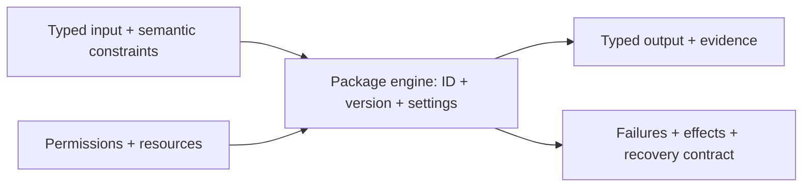

<!-- Teleion context: CHARTER.md sha256=6fe2bd046fd154952a79d25d81d1efcf8474ab4eabf034b105dcbe7b513e84ee; read AGENTS.md -->

# Design through package edges

The planner works with the edges. An engine may implement a pure function or call a service in another language. Package installation, execution authorization, semantic compatibility and task acceptance are separate decisions. Compose only registered entrypoints; never import an arbitrary path suggested by model prose.

The bundled `contracts.compose` deliberately handles sequential pure engines only. Durable DAG execution, retries, leases and effect reconciliation belong to existing provider engines and are tracked as external dependencies. This avoids claiming a small linear example is a replacement for the full compiler/queue.

Each module receives an entry in the package manifest; settings are package resources. Each engine entry lists its input/output semantics, effects, version and qualification scope. Keep one cohesive distribution where modules share a release; split distributions only when dependencies, ownership or deployment require it.

## Declarative package plans

`plans.compile_plan` resolves data-only engine IDs and exact version keys through a caller-admitted registry. It preflights every node, type/semantic/version edge and output before any engine runs, rejects cycles and declared effects, and freezes a deterministic topological order. Runtime branches receive separate snapshots. A failed node stops remaining execution and returns explicit records. Optional registered port validators check nested values before consumers; a validator must return the boolean True.

This subset supports fan-out over single-input engines. Conditional branches and multi-input joins are not supported. Trusted Python functions can still have undeclared side effects; a declaration and deepcopy are not a sandbox. The plan digest identifies serialized graph/contracts, not callable code, mutable closures, a deployment or cache eligibility. Registry owners must bind exact versions to admitted implementations. Shape and registered-validator checks still leave task acceptance to its checker.

`settings.load` exposes raw resources. `settings.select` accepts only normalized mapping entries with explicit enumerable grids; design catalogs and wrapper documents require explicit adapters and are refused. Selection enforces exact recursive value types and detaches values from caller objects. It does not enforce prose limits, external quotas or joint configuration compatibility.

Plan inputs, engine outputs, plan documents and selectable configuration values are restricted to finite plain JSON values with string object keys. Cycles, excessive nesting and custom Python objects are rejected before copy hooks can run. Branch isolation applies to this value boundary; registered implementations remain trusted Python code.

## Adaptive OmniNodes and inherited authority

The bundled stepkit.OmniNode configures stages from recorded evidence, selects permitted parts, derives child tasks, applies output checks, follows fallbacks and retains step/tree records. Its contract is an authority/resource boundary, not the whole node. Version0.2.1 rejects child part/model/store/cartridge allowlists wider than the parent's declarations. Before running stages it rechecks every ancestor's part/model/live permissions, including after child reconfiguration. Trusted implementations remain outside any sandbox guarantee. Full model-backed adaptation, hard cost reservation and storage-adapter enforcement require separate evidence.

Version 0.2.2 validates resolved permission, resource and numerical budget proposals against the owning contract declaration. Parameters, retrieved settings and exploration may narrow those bounds; widening raises ContractError before the value is used. Ordinary arrangement, fallback and retrieval settings remain adaptive. Resolver choices preserve proposals and their source, including rejected proposals; refusal context must accompany any interpretation as authority. These are running budget bounds, not concurrent reservations, and do not qualify every contract field or connector.

## Own-task policy (candidate 0.2.3)

Each node validates its own declared input form, output form, required output checks and task-text permission before execution. Input form cannot be changed by adaptive settings. Output form may narrow through known built-in subset relationships (any to text/number/choice, text to number/choice). Required checks cannot be removed; additional registered checks are allowed. Explicit derived child task contracts may have different forms and checks. records.task_text=False cannot becomeTrue through parameters or evidence.

The validated policy is frozen for the run and serialized in NodeRecord.effective_policy; contract remains the original declaration, and choices retain proposed values and provenance. These are maker checks, not independent task acceptance. Raw serialization is not a sanitizing writer. External legacy writers must consume effective retention policy explicitly; their behavior, data-use overrides, and summary redaction are not changed by this repair. Budget stopping and inherited resource authority retain their existing scope.
