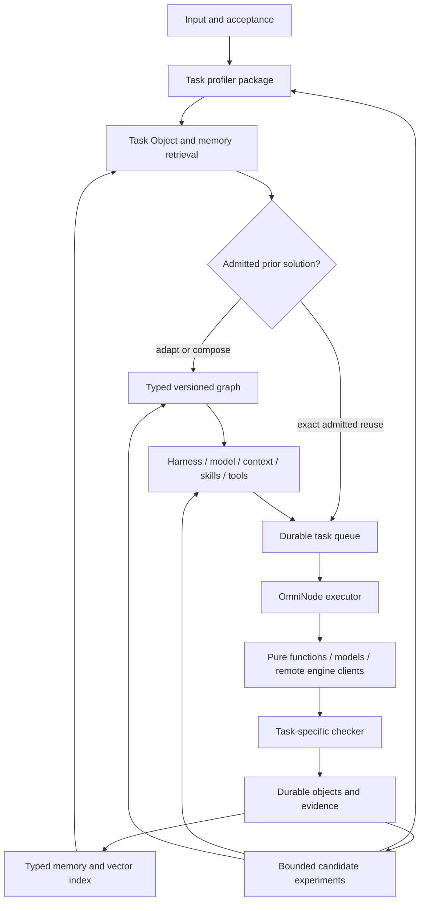
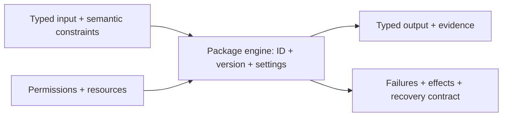

<!-- Teleion context: CHARTER.md sha256=6fe2bd046fd154952a79d25d81d1efcf8474ab4eabf034b105dcbe7b513e84ee; read AGENTS.md -->

# Design through package edges

The planner works with the edges. An engine may implement a pure function or call a service in another language. Package installation, execution authorization, semantic compatibility and task acceptance are separate decisions. Compose only registered entrypoints; never import an arbitrary path suggested by model prose.

The bundled `contracts.compose` deliberately handles sequential pure engines only. Durable DAG execution, retries, leases and effect reconciliation belong to existing provider engines and are tracked as external dependencies. This avoids claiming a small linear example is a replacement for the full compiler/queue.

Each module receives an entry in the package manifest; settings are package resources. Each engine entry lists its input/output semantics, effects, version and qualification scope. Keep one cohesive distribution where modules share a release; split distributions only when dependencies, ownership or deployment require it.
